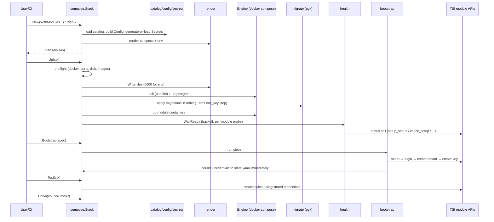

# tsi-cli: Technical Architecture

Companion to `IMPLEMENTATION_PLAN.md` (what and why, milestones, per-module recipes) and `USE_CASES.md`. This document describes **how the system is put together**: components, boundaries, data flow, state, and the contracts between them.

**Status:** the framework and four modules (`tsi-dpdp-cms`, `tsi-privacy-vault`, `tsi-compass`, `tsi-dx-node`) are implemented and verified against the real containers. `tsi-ledger` and `tsi-sign` are out of scope for the soft launch, and the sections of this document that describe them are the original design. See [Implementation notes](#17-implementation-notes-where-the-build-differs-from-the-design) for where the build differs from this design. Module facts come from the plan's reading of the six repos (`tsi-dpdp-cms`, `tsi-privacy-vault`, `tsi-ledger`, `tsi-compass`, `tsi-dx-node`, `tsi-sign`); items the plan marks **[I]** (inferred) are still unverified and are called out where they affect the design.

---

## 1. Architectural principles

1. **Library first, CLI second.** Every capability is a Go library call. `cmd/tsi` only parses flags and prints, so anything the CLI does can be done from `go test` or another program.
2. **Catalog is data, not code.** Differences between modules (ports, env names, setup calls, response fields, probes) live in embedded YAML. Adding a module means adding a file, not Go code.
3. **Drive the modules through their own APIs.** No changes to the modules and no direct DB writes except applying their shipped migrations.
4. **Idempotent and re-runnable.** A second run changes nothing. One-time secrets are persisted immediately and never silently regenerated.
5. **Secrets are first-class.** Generated, classified (secret / immutable), stored 0600, redacted in all output.
6. **Pluggable edges.** The container runtime (`Engine`) and the database mode sit behind interfaces so tests use fakes and later versions can swap implementations.
7. **Local and dev only in v1.** No Kubernetes, remote deploys, or telemetry.

## 2. System context

```
                        ┌───────────────────────────────┐
  Developer / CI / ─────►  tsi CLI  or  Go library user  │
  go test / agent       └───────────────┬───────────────┘
                                        │ in-process calls
                        ┌───────────────▼───────────────┐
                        │        tsi-cli (this repo)     │
                        └───┬───────────┬───────────┬────┘
              docker compose│       pgx │   HTTP/JSON│ (POST, X-API-Key/Secret, Bearer, cookie)
                        ┌───▼───┐   ┌───▼────┐   ┌───▼─────────────────────────┐
                        │Docker │   │Postgres│   │ TSI modules (Jetty, :8080)   │
                        │engine │   │(shared,│   │ cms, vault, ledger, compass, │
                        │       │   │per-mod,│   │ dx-node, sign                │
                        │       │   │or ext.)│   └──────────────────────────────┘
                        └───────┘   └────────┘
          Local disk: docker-compose.tsi.yml, .env.tsi, tsi.yaml, tsi.lock, .tsi/state.yaml, .tsi/audit.log
```

External dependencies: a Docker-compatible engine (v1 shells out to `docker compose`), Docker Hub images (`tsicoop/<name>`; `tsi-sign` is build-only), and a Postgres 15 instance (container or user-provided).

## 3. Layered component model

```
┌────────────────────────────────────────────────────────────────────┐
│ L5  Interface      cmd/tsi (cobra)  ·  MCP server (tsi mcp, later)  │
├────────────────────────────────────────────────────────────────────┤
│ L4  Orchestration  compose/  (Stack: Plan, Write, Up, Bootstrap,    │
│                    Test, Status, Logs, Down)                        │
├────────────────────────────────────────────────────────────────────┤
│ L3  Domain         bootstrap/   tsitest/   health/   migrate/       │
│                    render/      certs/     logs/                    │
├────────────────────────────────────────────────────────────────────┤
│ L2  Model          catalog/   config/   secrets/                    │
├────────────────────────────────────────────────────────────────────┤
│ L1  Infrastructure engine/ (docker compose CLI | fake)  ·  pgx      │
│                    net/http + cookiejar  ·  filesystem              │
└────────────────────────────────────────────────────────────────────┘
Dependencies point downward only. L5 never imports L3/L2 directly for behaviour.
```

### 3.1 Component responsibilities

| Package | Responsibility | Key inputs → outputs |
|---|---|---|
| `catalog` | Load and validate embedded per-module YAML and pinned migration assets | module name → `Module` descriptor |
| `config` | Typed config, defaults, validation; read/write `tsi.yaml` | user options + catalog → `Config` |
| `secrets` | Generate secrets, enforce immutability, persist state (0600) | `Config` + prior state → `Secrets` |
| `render` | `text/template` to compose YAML and env file; golden-tested | `Config` + `Secrets` + catalog → files |
| `engine` | `Engine` interface: pull, up, down, ps, logs, exec | compose file → container lifecycle |
| `migrate` | Apply a module's `db/*.sql` in order over pgx (including cms `app.enc_key` step) | DSN + module → applied versions |
| `health` | Readiness probes with backoff and per-module probe call | module endpoint → ready / not ready |
| `bootstrap` | Ordered, idempotent API-call runner with session handling | `BootstrapSpec` + catalog → `Credentials` |
| `certs` | PKCS#12 keystores, X.509 node identities (dx-node, cms, sign) | hostnames → keystore / cert files |
| `tsitest` | Per-module smoke suites, `Start(t, ...)` helper, JSON/JUnit reporters | `Stack` → `Result` |
| `logs` | Multiplex container logs with module prefixes | engine streams → `io.Writer` |
| `compose` | Public façade tying the above into `Stack` | options → lifecycle operations |

Library packages stay at top level (not `internal/`) so ISVs can import `compose` and `tsitest`. Only private helpers go under `internal/`.

## 4. The catalog (the central abstraction)

Each module is one embedded YAML descriptor validated by a schema at load time.

```yaml
name: tsi-ledger
image: {repo: tsicoop/tsi-ledger, tag: <pinned>}
services: {app: jetty_app, db: postgres_db}
ports: {app: 8086, db: 5438, container: 8080}
env:
  - {name: JWT_SECRET,   secret: true,  generator: random32}
  - {name: ALLOWED_ORIGINS, default: "http://127.0.0.1:8086"}
migrations: {dir: assets/tsi-ledger/db, files: ["01_init.sql"]}
ready:   {path: /api/v1/setup, body: {_func: setup_status}, expect: 200}
session: cookie                      # bearer | cookie
setup:   {path: /api/v1/setup, func: initial_setup, token_env: null, fields: [name, email, password]}
login:   {path: /api/v1/auth, func: login}
tenant:  {steps: [{path: /api/v1/app, func: create_app, body: {...}}]}
credential_fields: {key: api_key, secret: api_secret}   # sign uses camelCase
smoke:   [post_balanced_entry, reject_unbalanced, trial_balance]
```

What the descriptor absorbs (plan §5.3): JWT/token/image variable naming, compose service names, password minimums, JSON casing, credential field names, Bearer vs cookie sessions, and which secrets are immutable.

**Smoke tests and non-trivial recipes** (dx-node's two-node handshake, vault entity/permission seeding) are not expressible as flat YAML. The design allows a catalog entry to reference a **named Go step** registered in `bootstrap/recipes` or `tsitest/suites`; the YAML stays declarative for the common 80% and escape-hatches to code for the rest. (Plan says "no new Go code per module"; this is the known caveat for dx-node and sign.)

## 5. Core data model

```go
type Module struct { Name, Image, Tag string; Ports Ports; Env []EnvVar; Migrations Migrations; Ready Probe; Session SessionKind; Setup, Login Call; Tenant []Call; CredFields CredFields; Smoke []string }
type EnvVar struct { Name string; Secret, Immutable bool; Generator string; Default string }

type Config struct { Modules []ModuleConfig; DB DBConfig /* Shared|PerModule|External */; PortOffset int; Overrides map[string]string; Instances map[string]string }
type Secrets struct { Values map[string]string; Fingerprints map[string]string }   // fingerprints detect drift

type Credentials struct { Module, BaseURL, APIKey, APISecret string; AdminToken string /* not persisted */ }

type Plan struct { Files []FileChange; Containers []string; Migrations []string; BootstrapSteps []Step }
type Report struct { Modules []ModuleStatus }                                      // container health, ports, readiness
```

## 6. On-disk layout and state

```
<project>/
├── tsi.yaml                    # user intent: modules, db mode, bootstrap spec (committable, no secrets)
├── tsi.lock                    # pinned image tags + digests (committable)
├── docker-compose.tsi.yml      # generated (reviewable, committable)
├── .env.tsi                    # generated secrets, 0600, gitignored
└── .tsi/                       # gitignored
    ├── state.yaml              # 0600: generated secrets, admin creds, tenant API key/secret, applied migrations, bootstrap step ledger
    ├── certs/                  # keystores, node identities
    └── audit.log               # every mutating action (always on for MCP/agent use)
```

`state.yaml` is the single source of truth for things that **cannot be recovered from the modules** (admin passwords, API secrets, `DB_ENCRYPTION_KEY`, vault `MASTER_KEY`). If it is missing while containers/volumes exist, the library reports the situation and refuses to regenerate immutable secrets.

## 7. Key flows

### 7.1 Lifecycle: `init` → `up` → `bootstrap` → `test` → `down`



Ordering matters: **Postgres first, migrations before the app starts**, because the schema is not in the images. The library applies migrations over pgx rather than relying on `docker-entrypoint-initdb.d`, which keeps one code path for container, shared, and external Postgres and avoids waiting on container restarts.

### 7.2 Bootstrap runner

A bootstrap is an ordered list of **steps**, each with: an id, a precondition probe, an API call, a response extractor, and an "already done" rule.

```
for step in module.steps:
    if state.done(step.id): continue
    resp = session.call(step)               # Bearer header or cookie jar
    switch:
      2xx          -> extract fields -> state.record(step.id, fields) -> flush state (0600)
      409          -> "already done"; require saved creds in state, else fail with recovery message
      401/403      -> re-login once, retry
      other        -> typed error (module, step, hint)
```

Design points:

- **Two session kinds** behind one interface: `BearerSession` (cms, vault, compass, dx-node, sign) and `CookieSession` (ledger, `tsi_ledger_session`).
- **Credentials are written to state before the next step runs**: a crash after key creation must not lose a secret that is shown only once.
- **Setup tokens** come from generated env (`TSI_*_BOOTSTRAP_TOKEN`); ledger and sign have none.
- **Open first-run (ledger, sign):** ports are published on `127.0.0.1` until bootstrap completes. Widening is opt-in.
- **Rotation** is an explicit flag (`--rotate-key <module>`), never implicit.

### 7.3 Readiness

No module has `/health` or a Docker `HEALTHCHECK`. `health` therefore issues a cheap, unauthenticated, DB-touching status call defined per module (ledger/sign `setup_status`, compass `check_setup`, cms `list_active_fiduciaries`; vault and dx-node **[I]**, to confirm in M1). Polling uses exponential backoff with jitter and a ceiling; a 200 proves app and DB are both up. Readiness is separate from "setup done".

### 7.4 Secret handling

| Class | Examples | Rule |
|---|---|---|
| Generated, rotatable | `JWT_SECRET`, bootstrap tokens, index/lookup salts | Regenerate only with `--force` and when no data depends on it |
| **Immutable** | cms/compass `DB_ENCRYPTION_KEY`, vault `MASTER_KEY`, dx-node private key, sign keystore | Refuse regeneration once a volume or data exists; explain why |
| One-time upstream | tenant `api_secret`/`raw_api_key`, admin password | Stored on receipt; unrecoverable from the module |

Cross-cutting: insecure compose fallbacks (`secure_dev_password`, `changeit`) are never used; all log/CLI/JSON output passes through a redactor keyed on the secret classes above; `.gitignore` is updated on `init`.

### 7.5 Database modes

| Mode | Containers | Migration path | Notes |
|---|---|---|---|
| `shared` (default, pending Q1) | 1 Postgres, one DB + role per module | pgx | Fewer containers; role isolation per module |
| `per-module` | 1 Postgres per module, as the repos ship | pgx | Closest to upstream; separate host ports |
| `external` | none | pgx via user DSN | Preflight checks extensions (`pgcrypto`, `uuid-ossp`) and privileges |

### 7.6 dx-node multi-instance (special case)

Two `tsi-dx-node` instances need separate compose projects, env, ports (8082/8443 and offsets), an external Docker network `tsi-p2p-net`, and an overlay `docker-compose.p2p.yml`. `certs` generates per-node keys and self-signed certs whose CN/SAN match the hostname peers use (derived from the instance name); `bootstrap` then runs the cross-node handshake (register admin → import certificate → `create_partner` → `accept_partnership` → contract). This is modeled via `Instance(module, name)` and a dedicated recipe, and is the highest-risk component.

## 8. Public API surface

The library API is the one sketched in `IMPLEMENTATION_PLAN.md` §4.3 (`New`, `Configure`, `Plan`, `Write`, `Up`, `WaitReady`, `Bootstrap`, `Credentials`, `Test`, `Status`, `Logs`, `Down`, plus `tsitest.Start`). Architectural constraints on it:

- Every method takes `context.Context` and honours cancellation (including killing child `docker` processes).
- Mutating methods are safe to call twice.
- `Plan()` performs no side effects and is the basis for `--plan` and for confirm-before-run in agent use.
- Errors are **typed** (`*tsierr.Error{Code, Module, Step, Hint, Cause}`) and map to stable CLI exit codes.
- CLI output has two renderers over the same result structs: human and `--output json`.

## 9. Engine abstraction

```go
type Engine interface {
    Preflight(ctx) error
    Pull(ctx, images []string) error
    Up(ctx, project string, services ...string) error
    Down(ctx, project string, removeVolumes bool) error
    PS(ctx, project string) ([]Container, error)
    Logs(ctx, project string, w io.Writer, o LogOptions) error
    Exec(ctx, project, service string, cmd []string) ([]byte, error)
}
```

v1: `DockerComposeEngine` shells out to `docker compose` (compose-go validates generated YAML in tests). A `FakeEngine` records calls for unit tests. A Docker-SDK engine can implement the same interface later with no upper-layer change.

## 10. Testing architecture

| Level | Scope | Technique |
|---|---|---|
| Unit | catalog validation, secret rules, renderer, migration ordering, session handling, bootstrap runner | Golden files; `httptest` server with recorded responses; `FakeEngine` |
| Contract | catalog calls vs each module's `web/WEB-INF/validator/*.jschema` | CI job per module; live runs remain authoritative (some schemas are stale, e.g. vault `register_client`) |
| Integration (`-tags integration`) | real Docker: each module alone and combined; bootstrap twice (second run no-op); `tsitest` suites | Nightly/CI with Docker |
| Product-facing | `tsitest` smoke suites exposed to users; JSON/JUnit output | Same suites run against every module release |

## 11. Security model

- **Trust boundary:** the machine running `tsi`; everything is local. No telemetry, no outbound calls other than image pulls (and any module-configured KMS/S3 the user sets).
- **At rest:** `.env.tsi`, `state.yaml`, certs created 0600 in a 0700 directory; git-ignored automatically.
- **In transit:** loopback binding by default; no TLS between CLI and local modules.
- **In output:** central redactor; `creds` masks secrets unless `--show-secret`.
- **Destructive actions** (`down --volumes`, key rotation, overwriting secrets) require explicit flags or confirmation.
- **Agent/MCP mode (milestone M11):** fixed operation allowlist (no shell, no free-form API calls); secrets replaced by opaque handles in tool results; mandatory plan-then-confirm; audit log of every action.

## 12. Concurrency and performance

- Image pulls run in parallel; module bring-up after migrations is parallel across modules.
- Readiness polling per module is concurrent with a shared deadline.
- Bootstrap is sequential **within** a module (state-dependent) and parallel **across** independent modules (except dx-node pairs, which are coordinated).
- Targets: `init` < 1 min, `up` ready < 3 min on a warm machine.
- State writes are serialized with a file lock to protect against concurrent `tsi` invocations in the same project.

## 13. Versioning and reproducibility

- Catalog pins an image tag per module (only cms, vault, dx-node have git tags; others pinned by digest) and embeds that version's migrations. `tsi.lock` records resolved digests.
- Catalog schema is versioned; `tsi.yaml` carries a `version:` field so config can evolve.
- A new module version = catalog + migrations bump, verified by contract and integration CI.
- Compose output omits the obsolete `version:` key.

## 14. Dependencies

`compose-spec/compose-go/v2` (validation), `jackc/pgx/v5` (migrations), `spf13/cobra` (CLI), `charmbracelet/huh` (prompts), `gopkg.in/yaml.v3`, `go-pkcs12` (writing PKCS#12), stdlib `crypto/x509`, `embed`, `net/http/cookiejar`, `text/template`. Go and Docker required; Go is not currently installed on the dev machine.

## 15. Extension points

| To add… | Touch |
|---|---|
| A new TSI module | One catalog YAML + embedded migrations + smoke suite (a Go recipe only if the flow is non-linear) |
| A new container runtime | New `Engine` implementation |
| A new output (Kubernetes manifests, later) | New renderer behind `render`; no change to catalog/bootstrap |
| A new command group (`tsi verify`, `tsi vault`) | New package + cobra subcommand over existing library layers |
| Agent interface | `tsi mcp` over the `compose` façade |

## 16. Architectural risks and open decisions

| Item | Impact on architecture | Resolution path |
|---|---|---|
| **[I]** readiness calls for vault, dx-node; compass credential flow; sign login body | Probe and bootstrap definitions in catalog | M1 live verification |
| Shared vs per-module Postgres (plan Q1) | Default `DBConfig`, role/DB provisioning in `migrate` | Decide before M3 |
| Migration source: vendored vs fetched at build (Q3) | Build pipeline and `catalog/assets` provenance | Decide before M1 |
| `tsi-sign` has no image (Q4) | Engine needs a `build:` fallback from a local checkout | Decide before M4 |
| Catalog expressiveness vs Go recipes | Boundary between YAML and code | Settle after ledger + cms recipes (M6) |
| Open first-run setup (ledger, sign) | Localhost-only binding window during bootstrap | Built into `Up --bootstrap` flow |
| Secrets-never-reach-the-model absoluteness (Q6) | MCP tool result contract | Decide before M11 |

## 17. Implementation notes: where the build differs from the design

Found while building and running the four soft-launch modules against the real images.

| Design said | What was built, and why |
|---|---|
| `.env.tsi` holds the secrets | One env file per container under `.tsi/env/` (0600). Modules reuse variable names such as `JWT_SECRET`, so a shared file would collide |
| Helper named `tsitest.Start` | `testkit.Start`. `compose` imports `tsitest` for result types, so the helper lives in its own package to avoid an import cycle |
| Migrations run as the module role | `ALTER DATABASE ... SET app.enc_key` needs a superuser, so `set_database_setting` runs over the admin connection; SQL files run as the module role. Applied steps and checksums are kept in a `_tsi_cli_migrations` table in the module database, so a re-run skips them and a changed key or file is refused |
| Render with `text/template` | The compose file is built from typed structs and `yaml.Marshal`, which cannot produce invalid YAML. `text/template` is still used for env values and bootstrap bodies |
| Bootstrap is a flat step list | Added `volatile` (login re-runs every time), `recover` (finds an object a previous interrupted run already created, instead of failing on 409) and `select` (captures a field from a list response). `when` skips a step whose variable is unset |
| Policy publish activates the policy | It only moves the policy to `UNDER_REVIEW`. Publishing creates a draft ROPA entry, and publishing that entry activates the policy. The catalog has two extra steps for this |
| Keystore alias `tsi_fiduciary` | Java names a PKCS#12 entry without a friendly name `1`, and `go-pkcs12` cannot set a friendly name, so the alias is `1`. The cms only reads the keystore when `TSI_DPDP_CMS_ENV=production` |
| READ-only key gets 403 | The module answers 401 for a refused scope. The smoke test first proves the key works for a read, then expects 401 or 403 for the write |
| `up` with a stack that has no compose file | `Up` only asks Docker for container state once the compose file exists |
| External database | Containers reach the host through `host.docker.internal`, so the server must listen on a non-loopback address |
| Vault setup call is `register_admin` | The setup route only accepts `_func: create_user` with `role: SYSTEM_ADMIN`, a `username`, `email`, `active: true` and the setup token. Once an admin exists it answers **403** (not 409), so the catalog lists 403 as the already-done status for that step |
| Readiness is a status call | The vault has none that is public. The probe is a setup call with a wrong token, which the vault refuses with 401 before touching the database. A login probe would add a failed-login row to the audit log on every poll. The database is already proven by the migrations that ran first. The vault validates the body before the token, so the probe must be well formed or it gets 400 |
| HTTP status is the result | The vault can answer 2xx with an error in the body (`"status": 4xx`). `bootstrap.EffectiveStatus` uses the body status when it is higher, in both the runner and the smoke tests |
| One API call per step | Steps can `foreach` over a list in the spec (entities, permissions), each item with its own saved state id, and can treat a failing response containing given text (`duplicate key`) as already done |
| Vault master key is 32 bytes | The vault hashes whatever string it is given with SHA-256, so a 64-character hex string works. It and `INDEX_SECRET` are generated as immutable |
| One module, one service | A `modules` entry can be `module:instance` (for example `tsi-dx-node:node-a`). The instance name is the compose service, state key and env file name; instances get consecutive host ports, their own database and role (`tsi_dx_node_node_a`), their own secrets, and a per-instance hostname alias when the catalog lists one |
| Bootstrap runs one module at a time | Steps have a `phase`; the stack runs phase 1 on every instance before phase 2 on any. Steps can read `Peers` (the other instances: node id, address, certificate, and the variables their runner has captured) and `Node` (this instance, `sender`/`receiver`). This is how two nodes register each other before the handshake |
| Create calls are idempotent via 409 | dx-node resets an existing partner to Pending and creates a duplicate contract, so its recipe looks first (volatile look-up steps) and creates `unless` the object exists. `poll` waits for state that settles later, such as a partner becoming Active; `select.from` reads a nested list |
| Credentials are an API key | Compass keys cannot authenticate, and dx-node uses an admin session for everything except client transfers, so a module declares `credentials: admin` and the stack stores the admin login (plus an API key if one was issued) |
| Smoke checks pass or fail | A check can be skipped when it does not apply to an instance (sender-only checks on the receiver); skipped checks are counted separately |
| Admin password from one generator | `admin_password: strong` produces upper, lower, digit and special characters from `!@%^*_+`, the intersection of what the modules allow |
| Node identity | `certs.LoadOrCreateIdentity` makes an RSA-2048 key (PKCS#8) and a self-signed certificate per instance and never replaces them: peers pin the public key |
| dx-node runs on its own compose project and an external `tsi-p2p-net` | Both nodes share the stack's default network, and each answers to the hostname its image certificate is valid for (`node-a-server-1`, `node-b-server-1`). The nodes trust a peer by public-key match, which `tsi` pins by registering the generated certificates |

Not built yet: the dx-node synchronous lane (it needs a responder service), `Instance` and `Override` as library options (overrides are in `tsi.yaml`), the `logs` multiplexer beyond `docker compose logs`, release packaging, and the MCP layer.

### Migrations are fetched, not vendored

The images do not contain the schema, and the module repos apply it by mounting `db/` into Postgres's `initdb.d` (customers run the differential files on upgrade). `tsi` leaves that alone and does not copy the SQL into this repository:

- `catalog/modules/<m>.yaml` pins `migrations.source` (`repo`, `ref`, `dir`) and a `sha256` per file. Branch names are rejected as refs.
- `migrate.Fetcher` downloads `https://raw.githubusercontent.com/<repo>/<ref>/<dir>/<file>`, retries 5xx and network errors but not 404, verifies the checksum, and caches the verified bytes (an atomic write; a cache entry that no longer matches is re-downloaded). A mismatch is an error, nothing is cached or applied.
- `Up` fetches every file before it pulls images or starts anything, so failures leave no containers behind.
- `migration_dirs` in `tsi.yaml` reads a local directory instead, unverified but with a warning when a file differs from the pin.
- `make network-test` (run in CI) downloads every pinned file and checks it, which catches a wrong checksum or a moved tag.
- Updating a module: `hack/sums.sh <checkout> <ref> db` prints the `steps:` lines; set the new `ref`; run `make network-test`.

Scope: tsi is for local development, evaluation and CI. Production deployments follow each module repo's own guide.
